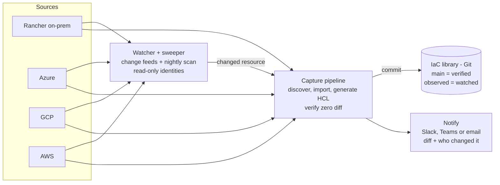

# Scriven — Blueprint

Nov 16, 2026 · @Kay

## Problem and goals

Some environments are running in production with no record of how they were built: no setup YAML, no IaC, no runbook. This tool captures what is actually deployed, turns it into Terraform, and keeps it in a versioned library that can be replayed on any platform Terraform supports.

Goals:

1. **Capture** deployed infrastructure from Rancher on-prem, AWS, Azure and GCP as Terraform HCL plus import state.
2. **Prove** each capture is faithful: `terraform plan` against the live environment shows zero changes.
3. **Keep** every capture in a Git-backed IaC library with metadata (owner, date, source, provider versions).
4. **Watch** continuously, read-only, and notify when anything changes, including who changed it.
5. **Stay harmless**: no agents on nodes, no write permissions, low API load.

## Architecture overview



The first capture and every later change go through the same capture pipeline, so the library only ever holds code that matches the live environment.

## Platform coverage

Each platform gets its native exporter for the first capture and its native change feed for watching. Terraform 1.5+ `import` blocks with `terraform plan -generate-config-out` are the common engine underneath all of them.

| Platform | First capture | Change feed (watcher) | Terraform provider |
| --- | --- | --- | --- |
| Rancher on-prem / K8s | `rancher2` provider for clusters, projects, users; cleaned manifests via tfk8s | Kubernetes watch API (informers) per cluster | `rancher2`, `kubernetes` |
| Azure | aztfexport (Microsoft) | Event Grid resource events + Resource Graph change history | `azurerm` / `azapi` |
| GCP | `gcloud beta resource-config bulk-export --resource-format=terraform` | Cloud Asset Inventory real-time feeds (Pub/Sub) | `google` |
| AWS | AWS Config / Resource Explorer inventory → generated import blocks (Former2 as a helper) | EventBridge on CloudTrail write events, or AWS Config stream | `aws` |

Terraformer is not used: it was archived in March 2026.

## Capture pipeline

A capture is only accepted when step 5 passes: the generated code must describe the live environment exactly.

1. **Discover**: list resources and their IDs per platform, using the exporters or inventory APIs above.
2. **Import blocks**: write one `import { to = ..., id = ... }` block per resource.
3. **Generate HCL**: run `terraform plan -generate-config-out=generated.tf`.
4. **Clean up**: drop computed and read-only attributes, swap secrets for vault references, pull repeated values into variables, group resources into modules.
5. **Verify**: `terraform plan` against the live environment must show zero changes. Any diff means the capture is incomplete.
6. **Commit**: write the code and `catalog.yaml` into the library and open a PR.

The same pipeline runs for a full first capture and for a single changed resource in watcher mode.

## Watcher mode

The watcher listens to each platform's own change feed instead of polling. It re-captures only what changed and tells people within minutes.

**Inputs**

- **Change feeds** (see Platform coverage): near-real-time events, cheap to consume.
- **Nightly sweeper**: a rate-limited full scan with backoff, off-peak, to catch anything the feeds missed or dropped.

**On each change**

1. Re-capture only the affected resource through the capture pipeline.
2. Diff the regenerated HCL against the library.
3. Classify it: **expected** if it matches a recorded Terraform run, otherwise **drift** (changed outside IaC).
4. Commit to an `observed` branch and open a PR against `main`.
5. Notify Slack, Teams or email with the diff, the resource, the environment, and the actor taken from CloudTrail, the Azure Activity Log, GCP audit logs or the Kubernetes audit log.

**Noise control**

- Debounce bursts: group events for the same resource over a short window into one capture.
- Ignore fields that change on their own (status, timestamps, autoscaler replica counts).
- An allow/deny list per environment to skip namespaces or resource types nobody needs captured.

## Security and read-only model

The tool cannot change anything because none of its identities can write. It is low-footprint but fully visible: named, tagged, documented and audited.

| Platform | Identity | Permissions |
| --- | --- | --- |
| AWS | IAM role `iac-capture-readonly`, assumed via OIDC | `ViewOnlyAccess`; add read on Config / Resource Explorer |
| Azure | Managed identity or workload identity | `Reader` at subscription or management group |
| GCP | Service account via workload identity federation | `roles/viewer` + `roles/cloudasset.viewer` |
| Rancher / K8s | Service account + Rancher read-only global role | ClusterRole with `get`, `list`, `watch` only; no read on Secret contents |

Rules:

- No long-lived keys: OIDC or workload identity everywhere.
- No agents on nodes or VMs: control-plane APIs only.
- Secret values are never captured; the library stores vault references.
- The library repo is private, with branch protection on `main`.
- The tool's own API calls appear in each platform's audit log under its named identity.

## IaC library layout

The library is one Git repo. It is also the tool's only state, so a restart loses nothing.

```
iac-library/
  envs/
    <env>/                # e.g. prod, staging, dr
      <platform>/         # rancher, aws, azure, gcp
        <scope>/          # cluster, account, subscription or project
          main.tf
          imports.tf
          variables.tf
          versions.tf     # pinned Terraform and provider versions
          catalog.yaml
  modules/                # shared modules extracted during clean-up
```

`catalog.yaml` records, per capture: owner, capture date, source account or cluster, tool version, Terraform and provider versions, resource count, and the result of the zero-diff check.

Branches: `main` = verified captures; `observed` = what the watcher saw, merged by PR after review.

## Tech stack and deployment

The tool is written in Go, because Terraform, the cloud SDKs and Kubernetes client libraries are all native there. It runs as two small containers.

| Component | Runs as | Job |
| --- | --- | --- |
| Watcher | K8s Deployment, 1 replica, in a management namespace | Consumes change feeds and K8s watches, triggers single-resource captures |
| Sweeper | K8s CronJob, nightly | Full, rate-limited capture of each scope; catches missed events |
| Capture runner | Library inside both | Runs the exporters and `terraform plan -generate-config-out` |
| Notifier | Library inside both | Slack / Teams webhooks, email |

Other pieces: Terraform CLI baked into the image with providers pinned and cached; a secrets vault for webhook tokens; Prometheus metrics (events seen, captures run, drift found, API errors).

It can run on the Rancher management cluster itself, or on any small cluster that can reach all four control planes.

## Gotchas and risks

| Risk | Mitigation |
| --- | --- |
| Secrets cannot be exported | Capture names and references only; replay pulls values from the vault |
| Generated code is flat and noisy | Clean-up step: variables, modules, removal of computed attributes |
| K8s objects owned by operators or controllers | Skip anything with an `ownerReferences` controller; capture the operator's CR instead |
| Provider version changes alter generated code | Pin Terraform and provider versions per capture in `versions.tf` |
| API rate limits on large estates | Event-driven watching, a sweeper with backoff, off-peak runs |
| Some resource types have no Terraform import support | List them in `catalog.yaml` as uncaptured so the gap is visible |
| Notification fatigue | Debounce, ignore volatile fields, per-environment allow/deny lists |

## Scope and limits

The tool captures infrastructure and configuration, not data. The library is a rebuild recipe, not a backup.

- **Out of scope**: database contents, persistent volume data, object-storage contents, secret values. Backups stay with the existing backup tooling.
- **Helm releases** on Rancher are captured as chart, version and values through the `helm` provider, not as the hundreds of manifests they render.
- **Fleet / GitOps bundles** are recorded as a pointer to their source repo and revision. If a GitOps repo already exists, it stays the source of truth.

**What "replay" proves**

1. Apply a capture to an empty sandbox (a fresh k3d cluster, or an empty cloud project or account).
2. Run the capture tool against that sandbox.
3. Diff the second capture against the first. Zero differences, apart from IDs and names the cloud assigns, means the capture can rebuild the environment.

Replay runs on every new capture of a pilot scope and monthly for the rest.

## Access to the tool itself

The tool can read everything everywhere, so it is a sensitive system in its own right and gets the same protection as production.

| Role | Can | Cannot |
| --- | --- | --- |
| Viewer | Read the library, see notifications | Run captures, change config |
| Operator | Run captures and replays, approve drift PRs for non-prod | Change `scriven.yaml`, scope or identities |
| Admin | Run the wizard, change `scriven.yaml`, add scopes | Merge their own config change without a second approver |

- Roles map to Git repo permissions plus a Kubernetes RBAC role on the tool's namespace.
- Every `scriven.yaml` change goes through a PR with one approval from another admin.
- The tool's cloud identities are owned by the platform security team, not by the tool's admins.

## Test lab

The Rancher path, the library, secrets and notifications all run locally in Docker. Azure and GCP have no full local emulators, so those paths need small real sandboxes with budget alerts.

| Real thing | Lab stand-in | Fidelity |
| --- | --- | --- |
| Rancher + downstream clusters | Rancher container + 2 k3d clusters (`prod-sim`, `dev-sim`) | High: real Kubernetes, real watch API |
| IaC library (GitHub/GitLab) | Gitea | High for push, branches and PRs |
| Vault | Vault in dev mode | High for references; in-memory only |
| Slack / Teams | Webhook catcher that logs every POST | Payload shape only |
| Email | Mailpit | High |
| AWS | LocalStack (free token, non-commercial) or Floci / fakecloud | Partial: CloudTrail, EventBridge and Config are limited |
| GCP | Pub/Sub emulator for the feed consumer + a real sandbox project | Partial locally |
| Azure | Real sandbox subscription | Real |

**Lab files** (`scriven-lab/`)

- `docker-compose.yml`: support services; `aws` and `gcp` are optional profiles.
- `lab-up.sh`: starts everything, creates the k3d clusters, seeds a sample app and a Helm release, applies the read-only RBAC.
- `lab-drift.sh`: makes three manual changes to `prod-sim` (scale, ConfigMap edit, new Service) for the watcher to catch.
- `lab-down.sh`: tears down; `--wipe` also removes data volumes.
- `sample/`: the sample workloads and the `scriven-readonly` ClusterRole (no access to Secrets).

**Lab acceptance checks**

- [ ] Wizard completes and every step's test passes against lab services
- [ ] Full capture of `prod-sim` passes the zero-diff check
- [ ] Replay of that capture onto a fresh k3d cluster re-captures with no differences
- [ ] `lab-drift.sh` produces 3 notifications and an `observed` PR in Gitea
- [ ] The tool's service account is refused when it tries to read a Secret or write anything

## Roadmap

Build one platform end to end before widening. Rancher comes first because it is the environment with the least documentation.

1. **Phase 1, one-shot capture**: setup wizard, then a CLI that captures one Rancher cluster and one cloud account, passes the zero-diff check, and commits to the library.
2. **Phase 2, all four platforms**: Azure, GCP and AWS exporters; `catalog.yaml`; module extraction in clean-up.
3. **Phase 3, watcher mode**: change feeds, single-resource re-capture, `observed` branch, Slack/Teams notifications with the actor.
4. **Phase 4, hardening**: nightly sweeper, noise control, metrics, replay tests that apply a capture to an empty sandbox.

## Setup wizard

The four open choices are not hard-coded. A setup wizard asks for them before the first run and saves them to one config file, which engineers can change at any time. The CLI is called `scriven`, after the old word meaning "to write down".

**Commands**

- `scriven init`: the interactive wizard for the first run. It writes `scriven.yaml` and tests every answer before saving.
- `scriven config edit`: re-runs the wizard with the current answers pre-filled.
- `scriven config set <key> <value>`: changes a single setting, e.g. `scriven config set notify.channels teams`.
- `scriven config validate`: re-tests the saved settings.

**Wizard steps**

| Step | Asks | Options | Tested by |
| --- | --- | --- | --- |
| 1. Scope | Which environments, clusters and accounts to capture, and which one is the pilot | Rancher clusters, AWS accounts, Azure subscriptions, GCP projects | Read-only login and listing one resource in each |
| 2. Library repo | Where the IaC library lives | GitHub, GitLab or on-prem Git: URL + credential reference | Test clone and push to a scratch branch |
| 3. Notifications | Which channels, per environment | Slack, Teams, email; one or more | Sends a test message |
| 4. Merge policy | Whether drift PRs need approval before `main` | Auto-merge, or N approvers; set per environment | Checks branch protection on `main` matches |

**Example `scriven.yaml`**

```yaml
scope:
  pilot: rancher/prod-cluster-01
  targets:
    - { platform: rancher, id: prod-cluster-01, env: prod }
    - { platform: azure, id: <subscription-id>, env: prod }
library:
  provider: gitlab            # github | gitlab | git
  url: https://git.example.com/infra/iac-library
  credentials: vault://scriven/git-token
notify:
  channels: [teams, email]
  teams_webhook: vault://scriven/teams-webhook
  email_to: [platform-team@example.com]
merge_policy:
  default: { approvals: 1 }
  prod: { approvals: 2 }
  dev: { auto_merge: true }
```

**Rules for changes**

- Secrets never go in the file; it holds vault references only.
- The file is kept in the library repo, so every change has an author, a date and a diff.
- The watcher reloads the file when it changes, with no restart. A setting that fails its test is rejected and the previous one stays active.
